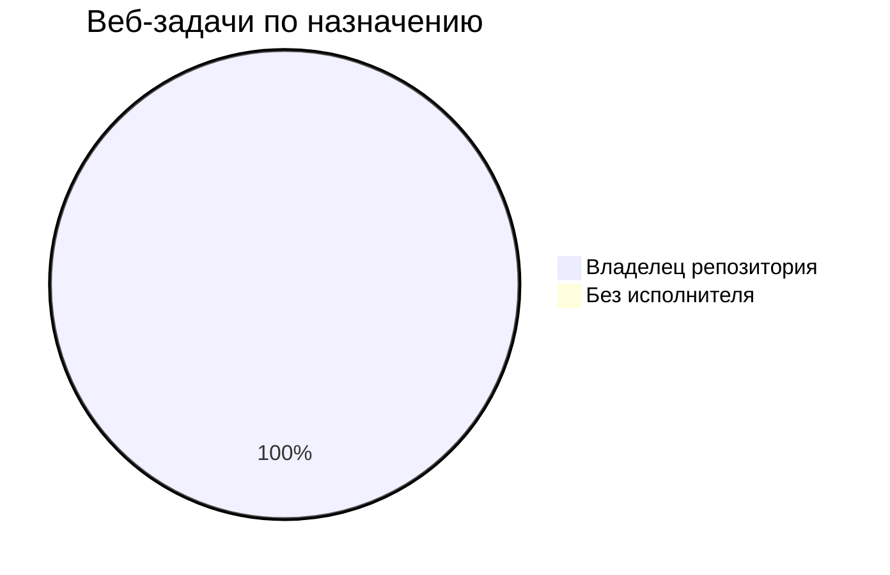

# Обучение продукту · PUL-Web

Исходный срез на момент выполнения лабораторной 2.2, 22 ноября 2026 года. В Project 12 карточек из репозитория курса. На момент снимка все 12 Issues были открыты. Текущее состояние задач доступно в [Issues](https://github.com/kziborova/Programmnaya_Inzheneriya/issues). Задачи №6 и №7 назначены владельцу, остальные десять без исполнителя. Плановая нагрузка двух назначенных задач — 8 ч.

| Стадия | Карточки |
|---|---:|
| Backlog | 9 |
| Approved | 1 |
| Coding | 1 |
| QA Approved | 1 |
| Done | 0 |

| Итерация | Карточки |
|---|---:|
| Sprint 1 | 8 |
| Sprint 2 | 3 |
| Sprint 3 | 1 |

[Веб-задачи](https://github.com/users/kziborova/projects/2/views/4) · [Kanban](https://github.com/users/kziborova/projects/2/views/2) · [Ускоренная дорожка](https://github.com/users/kziborova/projects/2/views/5).

